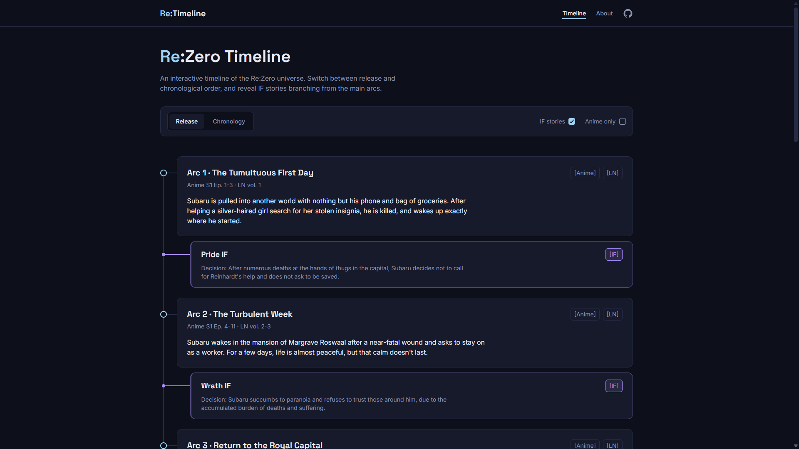
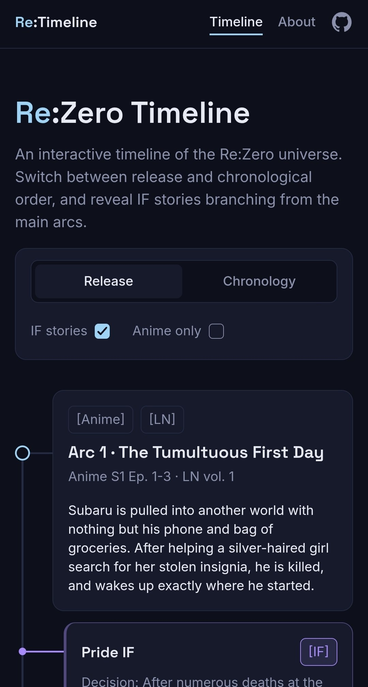

# Re:Timeline

An interactive timeline of the Re:Zero universe. Switch between release and chronological order, and reveal IF stories branching from the main arcs.

**[Live demo](https://re-timeline-pi.vercel.app/)** · **[Figma design](https://www.figma.com/design/xyD0WWsdpvFlaPxay3aqWC/Re-Timeline?node-id=190-1588&t=MGvbYGgSdr8t4man-0)**

<p>
  
  
</p>

## Features

- **Two orders:** browse arcs in release order or in story chronology
- **IF stories:** decision-fork branches shown under the arcs they split from (Pride, Wrath, Sloth, Greed, Gluttony)
- **Anime only filter:** hides content that exists only in the light novels, so you can browse without spoilers
- **Details modal:** key events for arcs, decision and consequences for IF stories
- **Responsive:** designed mobile-first, with a full-screen modal on phones
- **Two pages:** timeline and About, with client-side routing
- **Shareable URLs:** filters and the open arc are stored in the address

## Tech stack

- React + TypeScript
- Vite
- Tailwind CSS v4 (design tokens in `@theme`, custom text utilities)
- React Router
- pnpm

Data is static JSON, there is no backend.

## Run locally

```bash
git clone https://github.com/Atsui04/re-timeline.git
cd re-timeline
pnpm install
pnpm dev
```

Production build:

```bash
pnpm build
pnpm preview
```

## Design and decisions

The interface was designed in Figma first (dark theme, Space Grotesk + Inter, Auto Layout, components with variants), then built in code.

- **Mobile-first with a single breakpoint.** Base styles are for phones, and everything that differs on larger screens is added with `md:` (768px).
- **Modal.** Built on the native `<dialog>` element. On phones it is full-screen with a fixed header and a scrollable body, on larger screens it is a centered card.
- **Design tokens.** Colors and typography come from Tailwind `@theme` variables and custom text utilities, so the code and the Figma styles use the same names.

## Performance

Lighthouse (mobile, production build): **100** Performance · **100** Accessibility · **100** Best Practices · **100** SEO

Fonts are self-hosted with Fontsource to avoid render-blocking requests to Google Fonts.

## Project structure

```
src/
  components/
    about/      About page sections
    layout/     Header, footer, container, page intro
    modal/      Modal content for arcs and IF stories
    timeline/   Event and IF cards, filters, timeline row
    ui/         Badge, Modal
  data/         events.json
  pages/        TimelinePage, AboutPage
  utils/        sorting and filtering helpers
```

## Credits

Re:Zero © Tappei Nagatsuki / Kadokawa / White Fox. This is an unofficial fan project and is not affiliated with the rights holders. Arc names and facts are based on the Re:Zero Wiki, descriptions are written by me.

© 2026 Markiian Bushko
